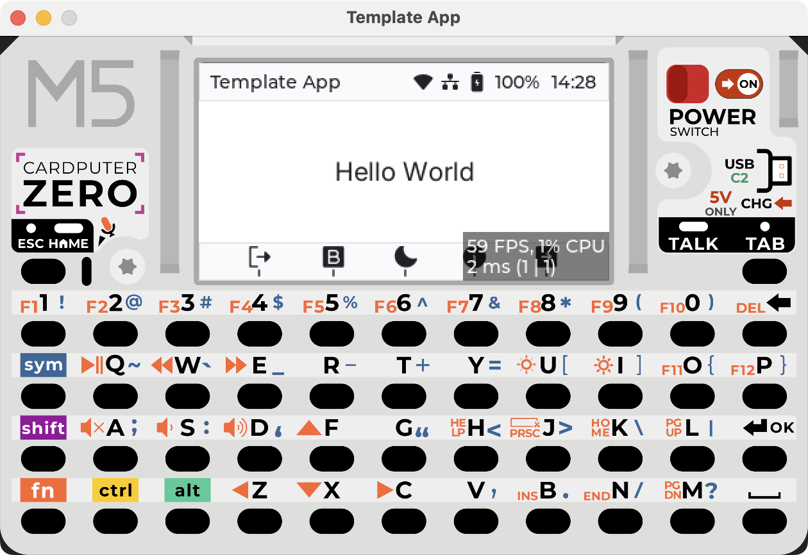

<p align="center">
  <picture>
    <source
      media="(prefers-color-scheme: dark)"
      srcset="./screenshot/app-simulator-dark-darwin.png"
    />
    <source
      media="(prefers-color-scheme: light)"
      srcset="./screenshot/app-simulator-light-darwin.png"
    />
  
  </picture>
</p>

<div align="center">
    <h1>ZeroSub</h1>
</div>

<div align="center">
  <p>A Sub-GHz radio, infrared remote and NFC tool for the CardputerZero and the M5Stack Cap CC1101, built with LVGL and CMake.</p>
</div>

<p align="center" style="margin: 20px 0; display: flex; justify-content: center; flex-wrap: wrap; gap: 12px;">
  
  
  
  
</p>

<p align="center">
  <a href="https://discord.gg/ysQAWBUE9Q">
    
  </a>
</p>
It is intended to be used as a clean development baseline: desktop builds use an SDL hardware-accelerated compositor for fast UI preview, while device builds use the Linux/LVGL platform drivers.

## Project Overview

In this example project, we used small MVVM-style structure around LVGL:

- **UI layer**: screens and widgets are implemented with LVGL objects. `BaseScreen` owns the page root, title bar, nav bar, and page content. Widgets derive from `BaseWidgets` and expose a `build()` entry point.
- **Data model**: `BaseModel` stores application state such as current page and theme mode.
- **View model**: `BaseViewModel` exposes model state as LVGL observer subjects and provides UI actions such as page switching, frequency selection, theme toggle, and quit request. It also owns the CC1101 radio session and polls it from an LVGL timer.
- **Reactive/data binding**: `src/reactive` wraps LVGL observer subjects and common bindings so labels, styles, flags, widget values, and events can be connected to application state.
- **Data flow**: a key press reaches the current screen, the screen calls a `BaseViewModel` action, view model publishes subjects, and bound UI objects refresh automatically through LVGL observers.
- **Platform layer**: platform code owns Linux input integration and other hardware-facing services. Key presses go first to the global shortcut handler (help, screenshot, `ESC`), then to the current screen's `on_key()`.

Pages, modelled on the Flipper Zero Sub-GHz app's feature set:

- **Main menu**: one row per tool, then settings. Today that is **Sub-GHz**, **Infrared**, **NFC** and the dark mode toggle; new tools get a row of their own here.
- **Sub-GHz menu**: one row per Sub-GHz page, listed below.
- **Frequency Analyzer**: sweeps 17 common Sub-GHz channels between 300 and 925 MHz, shows the strongest one and a level bar per channel.
- **Signal Meter**: live RSSI on one frequency, with a selectable modulation preset.
- **Read**: listens on one frequency and lists the remote keys it decodes. A decoded key can be saved as a Flipper-compatible `.sub` key file. Rolling codes are recognised and marked.
- **Saved**: browses the capture library, folders included, describes the selected file, and can delete it.
- **Add Manually**: creates a new fixed-code remote and saves it as a `.sub` key file.
- **Signal Info**: summary of one key, recording or saved file, with Send, Save and Delete.
- **Read RAW**: records the raw pulse train on one frequency, with a scrolling RSSI graph and a recording threshold, and saves it as a Flipper-compatible `.sub` file.
- **Infrared menu**: one row per Infrared page, listed below. See [Infrared](#infrared).
- **Learn New Remote**: listens for infrared remotes, lists the signals it decodes (or their raw timings), and saves them as Flipper-compatible `.ir` files.
- **Saved Remotes**: browses the remote library, folders included.
- **Remote**: the buttons of one `.ir` file; sends the selected one.
- **NFC menu**: one row per NFC page, listed below. See [NFC](#nfc).
- **Read Tag**: waits for an NFC-A, FeliCa, NFC-B (ISO 14443-B, ST25TB) or NFC-V (ISO 15693) tag on the Cap's ST25R3916 reader, reads it, shows the URL or text it holds, and saves it as a Flipper-compatible `.nfc` file.
- **Saved Tags**: browses the tag library, folders included.
- **Tag**: one saved tag; emulates it, or writes it to another tag.
- **125 kHz RFID menu**: Read, Saved, Add Manually and Key, for EM4100 keys on a home-made coil front-end.
  Hidden for now: the main menu has no row for it, though the code is still built. See [125 kHz RFID](#125-khz-rfid).

## Repository Layout

```text
.
├── assets/                 # Runtime assets used by the app
│   ├── applications/       # Desktop/app launcher metadata
│   ├── audio/              # Audio resources
│   ├── fonts/              # TTF fonts loaded through FreeType
│   └── images/             # Image resources
├── screenshot/             # Simulator screenshots for supported desktop platforms
├── src/
│   ├── app/                # Application lifecycle, asset loading, screen management
│   ├── config/             # LVGL config headers for desktop and device builds
│   ├── logger/             # Project logging wrapper
│   ├── model/              # Base application data model
│   ├── platform/           # Platform input/hardware integration
│   ├── reactive/           # LVGL observer subjects and binding helpers
│   ├── view/               # Theme, UI constants, screens, and widgets
│   │   ├── screens/        # Page-level LVGL screens
│   │   └── widgets/        # Reusable LVGL widgets such as nav bar and icon button
│   ├── viewmodel/          # BaseViewModel and UI-facing actions/state subjects
│   └── main.cpp            # Program entry point
├── CMakeLists.txt          # Build graph, dependencies, options, targets
├── CMakePresets.json       # Desktop/device configure and build presets
└── README.md
```

### Modules

- `src/app/asset_manager.*`: resolves runtime assets from the optional CMake asset root, source tree `assets/`, and installed `/usr/share/<APP_NAME>/` path.
- `src/app/screen_namager.cpp`: switches LVGL screens when the current page subject changes.
- `src/app/desktop_simulator_frame.*`: owns the desktop SDL window, renderer, high-resolution shell textures, input, and LVGL texture composition.
- `src/config/lv_conf_desktop.h`: desktop LVGL rendering settings.
- `src/config/lv_conf_cm0.h`: embedded Linux/CardputerZero LVGL settings.
- `src/platform/linux_input.*`: Linux evdev keypad support and desktop SDL keyboard routing for nav buttons.
- `src/reactive/subjects.*`: typed wrappers around LVGL subjects.
- `src/reactive/bindings.*`: helper bindings for labels, theme, widget values, flags, states, and events.
- `src/view/widgets/navbar.*`: bottom bar listing the keys the current page reacts to.
- `src/view/screens/page_keys.h`: shared previous / next / select key roles.
- `src/platform/cc1101.*`, `spi_device.*`, `gpio_line.*`, `cap_power.*`: CC1101 driver, spidev and GPIO access, and Cap power control.
- `src/platform/pulse_capture.*`: worker thread that turns GPIO edge events on the radio's data pin into pulse durations.
- `src/platform/capture_store.*`: capture directory, the Flipper `.sub` RAW and key file writers, file listing and delete.
- `src/platform/pulse_transmitter.*`: real-time worker thread that plays pulse durations on the same pin to key the carrier.
- `src/model/protocols/key_decoder.*`, `stream_decoders.*`: fixed-code protocol decoders.
- `src/model/protocols/key_encoder.*`: turns a key back into the pulse train to send.
- `src/model/protocols/rolling_codes.*`: which protocols are rolling codes, and the check that keeps them from being sent.
- `src/model/protocols/key_factory.*`: the remotes Add Manually can create, and how to make a valid key for each.
- `src/model/transmit_policy.*`: the bands the app is allowed to transmit in.
- `src/platform/ir_transceiver.*`: infrared receiver and transmitter on the kernel's LIRC devices.
- `src/platform/ir_store.*`: the remote library and the Flipper `.ir` file reader and writer.
- `src/model/infrared/ir_protocols.*`: infrared protocol decoders and encoders, and the collector that turns the receiver's marks and spaces into signals.
- `src/viewmodel/base_viewmodel_infrared.cpp`: the Infrared tool's state and actions.
- `src/view/screens/infrared_screen.*`: the three Infrared list pages.
- `src/platform/st25r3916.*`: ST25R3916 NFC transceiver driver, as a reader and as a listener (card emulation).
- `src/platform/nfc_worker.*`: the thread that runs one NFC job: read a tag, write a tag, or emulate one.
- `src/platform/nfc_store.*`: the tag library and the Flipper `.nfc` file reader and writer.
- `src/model/nfc/ndef.*`: reads the NDEF message in a tag's memory: URL, text, contact and other records.
- `src/model/nfc/nfc_tag.*`: what a tag is (UID, ATQA, SAK, NTAG / Ultralight memory), the type table, CRC, and the logic that answers a reader during emulation.
- `src/model/nfc/amiibo.*`: amiibo data on an NTAG215: checking it against the owner's retail key and re-signing it for a new UID (amiitool layout, built-in AES-128 and HMAC-SHA256).
- `src/viewmodel/base_viewmodel_nfc.cpp`: the NFC tool's state and actions.
- `src/view/screens/nfc_screen.*`: the three NFC pages.
- `src/model/rfid/em4100.*`: the EM4100 frame (header, row and column parity), its Manchester half-bits, and the decoder that turns reader pulses back into IDs.
- `src/platform/rfid_store.*`: the key library and the Flipper `.rfid` file reader and writer.
- `src/platform/rfid_emulator.*`: the real-time thread that plays a key on the coil front-end's GPIOs.
- `src/platform/rfid_reader.*`, `uart_carrier.*`: reading: the 125 kHz carrier from UART TX, the comparator edges fed to the EM4100 decoder, and the optional rev B mode relay.
- `src/viewmodel/base_viewmodel_rfid.cpp`, `src/view/screens/rfid_screen.*`: the 125 kHz RFID tool's state and pages.

## Build Options

Common CMake cache options:

| Option | Default | Description |
| --- | --- | --- |
| `USE_DESKTOP` | `ON` | Build SDL desktop simulator when `ON`; build embedded Linux target when `OFF`. |
| `APP_NAME` | `zerosub` | Application name used by installed asset lookup. |
| `APP_ASSETS_ROOT` | empty | Optional runtime asset root. Expected layout includes `fonts/`, `images/`, etc. |
| `APP_CONFIG_FILE` | platform default | Optional config path. Defaults to `config/zerosub.conf` for desktop builds and `/etc/zerosub.conf` for device builds. |
| `APP_KEY_INPUT_DEVICE` | empty | Optional Linux evdev device path, e.g. `/dev/input/event0`. Empty means auto-scan `/dev/input/event*`. |
| `APP_FRAMEBUFFER_DEVICE` | `/dev/fb0` | Linux framebuffer device used by embedded builds when `APP_USE_DRM=OFF`. |
| `APP_USE_DRM` | `OFF` | Use LVGL's Linux DRM/KMS backend instead of fbdev for embedded builds. |
| `APP_DRM_DEVICE` | `/dev/dri/card0` | DRM device path used when `APP_USE_DRM=ON`. |
| `APP_DRM_CONNECTOR_ID` | `-1` | DRM connector id used when `APP_USE_DRM=ON`; `-1` auto-selects. |

Asset lookup order:

1. `APP_ASSETS_ROOT` when provided by CMake
2. source-tree `assets/` for development
3. `/usr/share/<APP_NAME>/` for installed deployments

Theme startup behavior is configured in `config/zerosub.conf`:

```ini
[application]
dark_mode=yes
```

Set `dark_mode` to `yes` or `no`. The parser also accepts `true`/`false` and `1`/`0`.
Installed device builds use `/etc/zerosub.conf` as the system default. Changing the theme
from the navigation bar (keyboard shortcut `6`) writes a per-user override to
`$XDG_CONFIG_HOME/zerosub/zerosub.conf`, or `~/.config/zerosub/zerosub.conf`
when `XDG_CONFIG_HOME` is not set. The per-user file takes precedence on the next launch.

## CC1101 Radio

ZeroSub talks to the CC1101 on the M5Stack Cap CC1101 through a Linux spidev node. The driver lives in
`src/platform/cc1101.*` on top of the generic `src/platform/spi_device.*` wrapper.

Current behavior:

- **Receive:** the driver tunes the chip, enters continuous receive, reads RSSI, and can route the demodulated data to GDO0.
- **Transmit:** only from the Signal Info page, and only inside the EU bands listed under [Send](#send). The driver itself does not know about regional limits; the check lives in `src/model/transmit_policy.*`.
- **Frequencies:** the Flipper Zero default list of 17 channels: 300.00, 303.87, 304.25, 310.00, 315.00, 318.00, 390.00, 418.00, 433.07, 433.42, 433.92, 434.42, 434.77, 438.90, 868.35, 915.00, and 925.00 MHz.
- **Modulation presets:** AM270 and AM650 (OOK, 270 or 650 kHz bandwidth), FM238 and FM476 (2-FSK, 2.38 or 47.6 kHz deviation). The Signal Meter uses the selected one; the Frequency Analyzer always uses AM650.
- **Frequency Analyzer:** dwells 20 ms on each channel, so a full sweep takes about a third of a second. A channel counts as a signal at -85 dBm or stronger; that threshold has not been tuned on hardware yet. It reports the nearest listed channel, not the exact carrier frequency.
- **Radio lifetime:** the Cap is powered and the SPI device opened the first time a radio page is shown, and the chip is put back to idle when you return to the menu.
- **Desktop builds** have no SPI or GPIO access; the radio pages report that instead of showing a reading.

Configure the SPI node in `config/zerosub.conf` (installed as `/etc/zerosub.conf`):

```ini
[cc1101]
spi_device=/dev/spidev0.1
spi_speed_hz=500000
```

The Cap CC1101 radio is on `/dev/spidev0.1`. Set `spi_device` to an empty value to keep the radio disabled;
the app sends a reset command to the configured device on first use.

Cap power and GPIO, following M5Stack's Cap-CC1101-SubG-Chat reference app:

| Signal | Host control | Use |
| --- | --- | --- |
| `POWER_EN` | GPIO26 on `/dev/gpiochip0` | Driven high before the radio is opened. |
| EXT 5V rail | `/sys/class/leds/ext_5v_out/brightness` | Set to `1` if it is off. |
| `CC1101_RF_SW0` | GPIO14 on `/dev/gpiochip0` | Antenna switch: low below 374 MHz, high above. |
| Second antenna switch input | CC1101 `GDO2` | Constant low for 374-650.5 MHz, high otherwise. |
| `CC1101_G0` | GPIO15 on `/dev/gpiochip0` | Demodulated data input, only while the Read or Read RAW page is open. High impedance otherwise. |

- The Cap is powered the first time the radio page is shown, followed by a 1.5 s settling wait.
- The supply is **left on** when the app exits. The Cap shares its SPI bus with the LCD, and cutting
  the Cap's I/O supply can freeze the display.
- GPIO14's previous pin function is read with `pinctrl` and restored when the radio is closed. If it
  cannot be read, the pin is left alone and the status line shows `(RF switch not set)`.
- GPIO15 is handled the same way for Read and Read RAW: its previous function is restored when you
  leave the page, and if it cannot be read the page reports a capture error instead of taking the pin.

Permissions: the app needs access to `/dev/spidev0.1` and `/dev/gpiochip0`, and write access to the
`ext_5v_out` brightness file when that rail is off, which normally requires root. The Debian package
therefore installs `/etc/sudoers.d/zerosub`, which lets members of the `gpio` group run
`/usr/bin/zerosub` as root without a password and without arguments, and the launcher entry starts the
app through `sudo -n`. This is the same arrangement the official Cap apps use. From a shell, start it
with `sudo zerosub`.

Because the launcher runs the app as root, the per-user config override is written under root's home
(`/root/.config/zerosub/zerosub.conf`).

### Read RAW

The chip runs in asynchronous serial mode and puts the demodulated signal on GDO0. A worker thread
reads the kernel's GPIO edge events for that pin, which carry kernel timestamps, and stores the time
between edges in microseconds: positive for carrier on, negative for carrier off.

- **Threshold:** pulses are only kept while RSSI is at or above the threshold (default -70 dBm; `6`
  cycles Off and -85 to -40 dBm). The graph shows it as a horizontal line. With the threshold off,
  everything is recorded, including noise between transmissions.
- **Signal start:** RSSI is sampled every 30 ms, so the last 256 pulses from before the threshold was
  crossed are kept as well. Recording continues for 150 ms after the signal drops.
- **Gaps:** time skipped while below the threshold is stored as one long "off" period, so timing
  between bursts is preserved.
- **Limit:** a recording stops by itself at 200,000 pulses.
- **Lost edges:** if edges arrive faster than they can be read, the kernel drops some. The page reports
  how many were lost when you stop.
- **Timing accuracy** depends on Linux interrupt latency and has not been measured against a known
  signal yet.

Captures are saved as `RAW_<date>_<time>.sub` in the Flipper Zero "SubGhz RAW File" format, so they
can be copied to a Flipper and replayed or analyzed there. The directory is set in the config:

```ini
[storage]
directory=
```

This folder is the capture library: captures are saved to it, and the Saved page browses it. Left
empty, it is chosen like this:

1. `zerosub/sub-ghz` on an external SD card, if one is mounted. The first file system mounted under
   `/media`, `/run/media` or `/mnt` counts as the card; the system's own partitions never do.
2. Otherwise `~/zerosub/sub-ghz` of the user who started the app. When the launcher starts it through `sudo`,
   that is the invoking user's home, and the files are owned by that user, not root.

`zerosub` is the app's data folder, and each module gets its own folder inside it: `sub-ghz` here,
`Infrared` for the [Infrared](#infrared) tool and `NFC` for the [NFC](#nfc) tool. The folder is created the first time the Saved
page is opened or a capture is saved, so there is somewhere to copy files into.

The app does not mount an external card itself. To use a different folder, set the path, for example
`directory=/home/pi/remotes`.

Captures saved by versions before 0.5.0 are in `~/zerosub` itself and are not moved automatically.

### Read

Read uses the same pulse capture as Read RAW, with no threshold, and feeds every pulse to the
decoder in `src/model/protocols/key_decoder.*`.

| Protocol | Bits | Notes |
| --- | --- | --- |
| Princeton | 24 | PT2262-style remotes and many generic 433 MHz sockets and doorbells |
| Linear | 10 | |
| CAME | 12, 18, 24, 25 | Holtek HT12X remotes send the same signal and are listed as CAME 12 bit |
| Nice FLO | 12, 24 | |
| Ansonic | 12 | |
| Holtek | 40 | |
| GateTX | 24 | |
| SMC5326 | 25 | |
| LinearDelta3 | 8 | |
| Clemsa | 18 | |
| BETT | 18 | |
| Doitrand | 37 | |
| Dooya | 40 | |
| Phoenix_V2 | 52 | |
| Hormann HSM | 44 | |
| Nero Sketch | 40 | |
| Nero Radio | 56 | Needs 200 us pulses timed to within 80 us |
| Magellan | 32 | Checksum verified. Needs 200 us pulses timed to within 100 us |
| Honeywell | 48 | Wireless doorbell. Parity verified. Needs 160 us pulses timed to within 60 us |
| MegaCode | 24 | |
| Cham_Code | 7, 8, 9 | Chamberlain DIP-switch remotes |
| Intertechno_V3 | 32, 36 | |
| Marantec | 49 | Manchester coded |
| CAME TWEE | 54 | Manchester coded |
| Power Smart | 64 | Manchester coded. Needs 225 us pulses timed to within 100 us |

The names are the ones Flipper Zero uses in `.sub` files.

- Princeton, Linear, CAME, Nice FLO and Ansonic send pulse-width-coded bits between long silent gaps.
  For these the decoder (`key_decoder.*`) collects one frame at a time, works out the bit layout from
  the timing, and measures the pulse length instead of assuming it, so remotes that run faster or
  slower than nominal still decode.
- The other protocols have fixed timing and are decoded by small state machines in
  `stream_decoders.*`, using the timings from the Flipper Zero firmware. Most share one table-driven
  machine, so adding a similar protocol is one row in `kPwmSpecs`.
- The protocols marked as needing tightly timed pulses may not decode reliably on this hardware:
  edges are timestamped by Linux, not by a microcontroller timer, and the timing error has not been
  measured.
- Two protocols can match the same signal when their timings overlap (for example BETT and Clemsa);
  both are then listed.
- A key is listed only after the same frame has been seen twice within half a second. Holding the
  button raises the repeat count on its row instead of adding rows.
- Most remotes of these types use OOK, so AM650 (the default) or AM270 is the right modulation.
- Rolling-code remotes (most cars and newer garage doors) are recognised but not decoded further;
  see [Rolling codes](#rolling-codes).
- Saved keys are named after the protocol and key, for example `Princeton_95D5D4.sub`, and use the
  Flipper Zero "SubGhz Key File" format.
- Every protocol has been tested against synthetic signals built from its timing table, with at least
  3% timing jitter (10% for most), and against random noise, which produced no keys. None has been
  tested against a real remote yet.

### Rolling codes

A rolling-code remote sends a different code on every press, and its receiver only accepts codes newer
than the last one it saw. Read recognises these frames so you can see them, and so the app can refuse
to send them.

| Protocol | Bits | Shows the remote |
| --- | --- | --- |
| KeeLoq | 64 | Serial number and button |
| Star Line | 64 | Serial number and button |
| Somfy Telis | 56 | Serial number and button |
| Somfy Keytis | 80 | Serial number and button |
| Nice FloR-S | 52, 72 | No |
| CAME Atomo | 62 | No |
| Faac SLH | 64 | No |
| KingGates Stylo4k | 89 | No |
| Alutech AT-4N | 72 | No |
| Scher-Khan | 35 - 64 | No |

- In the Read list they are marked `[R]`. Where the frame carries the serial number and button
  unencrypted, the row shows those instead of the code, and pressing the same button again updates
  that row (the code is new each time) and raises its count.
- One frame is enough to list a rolling code. Fixed codes still have to be seen twice; rolling-code
  frames are long and rigidly structured, and a remote may send a code only once or twice.
- Signal Info shows the type and, where known, the remote. `5` saves the frame as a key file for
  reference. There is no Send.
- Nothing is decrypted. The counter and the encrypted part are shown only as the raw code, and the
  app cannot produce the next code of a remote it has heard.
- Four frames are longer than the 64 bits a key holds. Their remaining bits are kept as well, shown
  after the key as `+XXXX` on Signal Info, and written to the file in the field the Flipper Zero uses:

  | Protocol | Frame | Key | Extra bits | Field in the file |
  | --- | --- | --- | --- | --- |
  | Nice FloR-S (Nice One) | 72 | 52 | 20 | `Data` (number) |
  | Somfy Keytis | 80 | 56 | 24 | `Duration_Counter` (number) |
  | Alutech AT-4N | 72 | 64 | 8 | `CRC` (number) |
  | KingGates Stylo4k | 89 | 53 | 36 | `Data` (hex bytes) |
- Security+ 1.0 and 2.0, KIA and iDo are not recognised. A key file with one of those protocol names
  (from a Flipper Zero) is still treated as a rolling code and not sent.
- Timings come from the Flipper Zero firmware. Each protocol is tested against a synthetic frame built
  from them, alone and repeated, with up to 8% timing jitter. None has been tested against a real
  remote.

### Saved

A file browser for the capture library (see the `[storage]` setting above). Copy your own `.sub` files
into that folder, in sub-folders if you like, and they show up here.

- Folders are listed first (with a trailing `/`), then `.sub` files, each in alphabetical order.
  Other files and hidden entries are not shown.
- `Enter` sends the selected file straight away, under the same rules as Send on the Signal Info
  page (EU bands only, no rolling codes). Progress and the result appear on the bottom line, and
  `ESC` stops a transmission without leaving the page. On a folder, `Enter` opens it.
- `C` enters the selected folder, or opens the summary of the selected file. `Z` or `ESC` goes up one
  folder; at the top, `ESC` returns to the Sub-GHz menu.
- The line under the list shows the protocol, bit count and frequency of the selected file, and the
  bottom line shows the folder being browsed.
- `8` asks for confirmation and a second `8` deletes the selected file permanently. Folders cannot be
  deleted, created or renamed on the device; do that on a computer or over SSH.
- New captures are always saved to the top folder of the library.

### Add Manually

Creates a remote of your own instead of capturing one. The receiver does not know the new remote: put
it in its learning mode (the same procedure as for adding a bought remote) and send the key so that it
learns it.

The page is a four-line form:

| Field | Choices |
| --- | --- |
| Protocol | The 21 fixed-code types listed below |
| Frequency | The 17 channels of the frequency list; 433.92 MHz to start with |
| Modulation | AM270, AM650, FM238, FM476; AM650 to start with |
| Key | Random to start with, and editable digit by digit in hex |

- `F` / `X` select a field. `Z` / `C` change it; on the key they move the digit cursor, and `7` / `8`
  lower and raise that digit. `6` makes a new random key.
- `Enter` saves the remote as a `.sub` key file in the capture library and opens its Signal Info page,
  where `Enter` sends it. `ESC` from there goes to Saved, where the new file is listed.
- Changing the protocol starts a new random key, since a key made for one protocol means nothing in
  another.
- Where a protocol fixes some bits (the Holtek header, the leading 1 of Marantec and MegaCode, the
  fixed bits of Hormann HSM), those bits snap back when you edit them, so the key shown is always
  valid.
- Any frequency can be chosen and saved. If it is outside the EU transmit bands the page says so: the
  file can be used on another device, but this app will not send it.

Protocols: Princeton 24, CAME 12 and 24, Nice FLO 12 and 24, Linear 10, LinearDelta3 8, GateTX 24,
Holtek 40, Ansonic 12, SMC5326 25, Clemsa 18, BETT 18, Doitrand 37, Dooya 40, Phoenix_V2 52,
Hormann HSM 44, Intertechno_V3 32, Marantec 49, MegaCode 24 and Cham_Code 9.

- Only fixed codes can be created. Creating a rolling-code remote (one whose counter the app advances
  on every send) is not implemented.
- Whether a receiver accepts a made-up key depends on the receiver. Some only learn remotes of their
  own brand's key ranges.
- Every protocol is tested by creating keys, including all-zero and all-one, encoding them and
  decoding them back. None has been paired with a real receiver.

### Signal Info

A summary page for one signal. `ESC` returns to the page it was opened from.

| Opened from | Key | Shows | Actions |
| --- | --- | --- | --- |
| Read, on a decoded key | `C` | Protocol and bits, key, frequency, modulation, pulse length, times seen | `Enter` sends, `5` saves |
| Read RAW, when stopped | `C` | Frequency, modulation, pulse count, length, shortest pulse | `5` saves, then returns to Read RAW |
| Saved, on a file | `C` | The same fields, read from the file | `Enter` sends, `8` then `8` again deletes |

- The summary of a decoded key is a copy, so it does not change if more keys arrive. The radio stops
  listening while the summary of a key or a saved file is open and resumes on return.
- The summary of a recording keeps the Read RAW session open, so the recording is not discarded.
- A saved RAW file is read in full to count its pulses, which takes a moment for large files.

### Send

`Enter` on the Signal Info page transmits the key or saved file being shown, once. `ESC` or leaving
the page stops it. `Enter` on a file in the Saved list does the same without opening the summary.

**Where it transmits.** Only in the European licence-exempt bands that remotes use:

| Band | Channels from the frequency list |
| --- | --- |
| 433.050 - 434.790 MHz | 433.07, 433.42, 433.92, 434.42, 434.77 |
| 868.000 - 868.600 MHz | 868.35 |

Anything else is refused with a message, including files recorded elsewhere at 300 - 418, 438.90, 915
or 925 MHz. The bands are fixed in `src/model/transmit_policy.cpp`; they are not a setting. Receiving
is not restricted. Duty-cycle limits (10% in the 433 MHz band, 1% in 868.0 - 868.6 MHz) are not
enforced: do not hold a transmission in a loop.

**What it sends.**

- A key (decoded on the Read page, or a saved key file) is rebuilt from the protocol, bit count and
  key by `src/model/protocols/key_encoder.*`, the reverse of the decoder. One press sends what one
  press of the original remote sends: usually ten repeats of the frame, between a quarter of a second
  and three seconds depending on the protocol. All 26 protocols in the Read table can be sent.
- A saved RAW file is played back pulse for pulse, up to 200,000 pulses.
- An unsaved Read RAW recording cannot be sent directly: save it, then send it from Saved.
- Files using a modulation other than the four presets (Flipper "custom preset" files) are refused.

**How.** The CC1101 stays in asynchronous serial mode: its GDO0 pin becomes the data input and the app
keys the carrier by driving GPIO15, the same line it reads when receiving. Output power is the
CC1101 setting `0xC0`, about +10 dBm at 433 MHz.

- Edges are timed by a thread with real-time priority against absolute deadlines, sleeping through
  long gaps and spinning for the last half millisecond before every edge. Linux is not a real-time
  system, so an edge can still be late. After each transmission the page shows how late the worst
  edge was; a few tens of microseconds is fine for every protocol here, several hundred is not.
- The Cap has no separate transmit/receive switch as far as the reference driver shows, so the
  antenna path is selected by band exactly as for receiving. This has not been verified on hardware.

**Rolling codes are never sent.** A rolling-code key has no Send action, whether it was just decoded
or loaded from a file. Before a RAW file is sent it is run through the decoders, and it is refused if
it holds a rolling-code frame. That check only knows the protocols listed under
[Rolling codes](#rolling-codes): a rolling code the app cannot recognise, inside a RAW file, is sent
like any other recording. It would not work as a replay anyway, because the receiver only accepts
codes newer than the last one it saw.

Every encoder is tested by encoding a key and decoding the result back, with up to 10% timing jitter.
Nothing has been transmitted on real hardware yet.

Known limitations:

- No renaming of saved files on the device.
- Leaving the Read RAW page discards an unsaved recording without asking.
- The frequency calculation assumes a 26 MHz crystal, as the reference driver does.
- Power the device off before attaching or removing the cap; it does not support hot-swapping.

## Infrared

The Infrared tool learns remote controls, saves them as Flipper Zero `.ir` files, and sends them
again. It is modelled on the Flipper Zero Infrared app and uses the same file format and protocol
names, so remotes can be copied between the two in either direction.

It talks to the kernel's LIRC devices (`/dev/lirc*`); the code is in `src/platform/ir_transceiver.*`.

- **Receive:** the receiver device is read in "mode2": the kernel timestamps every edge of the
  demodulated signal and the app gets the durations of the marks (carrier seen) and spaces.
- **Send:** the app hands the kernel a list of mark and space durations plus the carrier frequency
  and duty cycle; the kernel driver generates the carrier and does the timing.
- **Devices:** left unconfigured, the first `/dev/lirc*` that can receive and the first that can send
  are used. If the system has no such device (the kernel's IR receiver or transmitter driver is not
  enabled), the Learn page and Send say so. The app does not load drivers or touch GPIO for infrared.
- **Desktop builds** have no LIRC; Learn and Send report that. Saved Remotes works everywhere.

```ini
[infrared]
receive_device=
send_device=
directory=
```

Set `receive_device` / `send_device` to a path such as `/dev/lirc0` to choose a device yourself.
`directory` is the remote library. Left empty it is the `Infrared` folder inside the app's data
folder, next to `sub-ghz`: `zerosub/Infrared` on an external SD card if one is mounted, otherwise
`~/zerosub/Infrared` (see [Read RAW](#read-raw) for how the card is found). The folder is created the
first time Saved Remotes is opened or a signal is saved.

### Learn New Remote

Listens and lists what it receives, newest first. Point the remote at the device and press a button.

| Protocol | Address / command bits | Carrier | Notes |
| --- | --- | --- | --- |
| NEC | 8 / 8 | 38 kHz | |
| NECext | 16 / 16 | 38 kHz | A 32-bit NEC frame without the usual inverted bytes |
| NEC42 | 13 / 8 | 38 kHz | |
| NEC42ext | 26 / 16 | 38 kHz | |
| Samsung32 | 8 / 8 | 38 kHz | |
| RC5 | 5 / 6 | 36 kHz | Manchester coded |
| RC5X | 5 / 6 | 36 kHz | RC5 with the second start bit cleared |
| RC6 | 8 / 8 | 36 kHz | Mode 0 only |
| SIRC, SIRC15, SIRC20 | 5 / 7, 8 / 7, 13 / 7 | 40 kHz | Sony. Sent three times per press |
| Kaseikyo | 26 / 10 | 38 kHz | Panasonic and others. Both parities verified |
| RCA | 4 / 8 | 38 kHz | |
| Pioneer | 8 / 8 | 40 kHz | Sent twice per press |

- A decoded signal is listed as protocol, address and command, for example `NEC  A:04 C:08  x3`.
  Holding the button raises the count on its row instead of adding rows.
- Anything that is not one of these protocols is listed as `RAW` with its number of timings and its
  length. Air conditioners are the usual case: they send one long frame holding the whole state.
- A signal is everything up to 150 ms of silence. A raw signal holds at most 1024 timings, as on the
  Flipper Zero; anything shorter than 7 timings is treated as a glitch and dropped.
- `Enter` saves the selected signal as a remote with one button, named after the protocol, address
  and command (`NEC_04_08.ir`) or, for a raw signal, the time (`RAW_<date>_<time>.ir`).
- `6` saves every signal in the list as the buttons of one remote, `Remote_<date>_<time>.ir`, in the
  order they were received. Buttons are named after the protocol and command (`NEC_08`), or `RAW`.
- `C` opens the summary of the selected signal, where `Enter` sends it and `5` saves it. The receiver
  is closed while the summary is open, so the app does not hear its own transmission.
- The decoders work on one frame at a time and match on the length of a mark plus the space after
  it. A receiver module stretches every mark and shortens every space, often by more than 100 us,
  but the sum of the two is what the remote sent. Timings and bit layouts come from the Flipper Zero
  firmware.
- A receiver module cannot measure the carrier. Raw signals are saved as 38 kHz with a 33% duty
  cycle, which is what nearly every remote uses; edit the `frequency` line of the file if a device
  needs another one.

### Saved Remotes

A file browser for the remote library. Copy your own `.ir` files into that folder, in sub-folders if
you like, and they show up here.

- Folders are listed first (with a trailing `/`), then `.ir` files, each in alphabetical order.
- The line under the list shows the number of buttons of the selected remote and their names.
- `C` or `Enter` opens the selected folder or remote. `Z` or `ESC` goes up one folder; at the top,
  `ESC` returns to the Infrared menu.
- `8` asks for confirmation and a second `8` deletes the selected remote permanently.
- Both Flipper file types open: a remote (`IR signals file`) and a universal remote
  (`IR library file`), which is simply a long list of buttons, many with the same name.

### Remote

The buttons of one `.ir` file, in file order.

- `Enter` sends the selected button, once. The bottom line shows progress and the result.
- `C` opens the button's summary: protocol, address and command, or the carrier and length of a raw
  signal. `Enter` sends from there as well.
- `8` asks for confirmation and a second `8` removes the button from the file. The file is rewritten
  in one step, so a failed write leaves the remote as it was; comments in the file are not kept.
- A decoded button is rebuilt from its protocol, address and command by
  `src/model/infrared/ir_protocols.*`. One press sends what the shortest press of the original remote
  sends: one frame, or three for SIRC and two for Pioneer. RC5 and RC6 flip their toggle bit on
  every send, as a real remote does on every new press.
- A button whose protocol the app does not know is listed and can be deleted, but not sent.
- A long signal is handed to the kernel in pieces, cut at a silence of 15 ms or more, because one
  write is limited to half a second and 1024 durations.

Known limitations:

- Buttons and remotes cannot be named or renamed on the device, and a learned signal cannot be added
  to an existing remote; edit the `.ir` file on a computer.
- Holding `Enter` does not send repeat frames; every press sends one message.
- There is no universal-remote search (trying every "Power" in a library until the TV reacts). A
  library file opens as an ordinary remote instead.
- Every protocol is tested by encoding random messages, distorting the timing the way a receiver
  does (marks up to 150 us longer, clock up to 4% off, jitter) and decoding the result, and against
  random noise, which decoded nothing.
- On the device, RC6 has been learned from a real remote and sent back, and a raw signal has been
  learned and sent. The other protocols have not been tried against real devices yet.

## NFC

The Cap CC1101 carries a second radio next to the CC1101: an ST25R3916 13.56 MHz NFC transceiver with
its own antenna. The NFC tool reads NFC-A tags with it, saves them as Flipper Zero `.nfc` files, writes
saved NTAG / Ultralight tags to other tags, and emulates saved tags to a reader. It is modelled on the
Flipper Zero NFC app and uses its file format, so tags can be copied between the two.

> [!IMPORTANT]
> None of the NFC code has been run on the hardware yet. It compiles for the device, and the parts
> that need no hardware (file format, CRC, the logic that answers a reader) are unit-tested. The
> register values and the sequences for this antenna are taken from M5Stack's own driver for this Cap,
> but reading, writing and emulating all still need to be tried against real tags and readers.

The driver is `src/platform/st25r3916.*`. Its chip set-up follows M5Stack's
[M5Unit-NFC](https://github.com/m5stack/M5Unit-NFC) library (MIT) and the CardputerZero
[Cap-CC1101-NFC](https://github.com/CardputerZero/Cap-CC1101-NFC) app.

| Signal | Host | Use |
| --- | --- | --- |
| SPI | `/dev/spidev0.2`, mode 1, 5 MHz | SPI0 with a third chip select, CS2 on GPIO22 |
| `IRQ` | GPIO23 on `/dev/gpiochip0` | The chip's interrupt output, read as rising edges |
| Power | GPIO26 `POWER_EN` and the EXT 5V rail | The same supply as the CC1101; see [CC1101 Radio](#cc1101-radio) |

- **The SPI node.** The stock device tree has no third chip select on SPI0. The BSP ships an overlay
  that adds it, `spi0-spidev2-gpio22-overlay`. When `/dev/spidev0.2` is missing the app loads that
  overlay itself (`dtoverlay -d /boot/firmware/overlays spi0-spidev2-gpio22-overlay`), which needs root
  and lasts until reboot. If that fails, add `dtoverlay=spi0-spidev2-gpio22-overlay` to
  `/boot/firmware/config.txt` and reboot once.
- **Lifetime.** The chip is opened when a read, a write or an emulation starts and released when it
  ends or the page is left; the field is off in between. Each job runs on its own thread, so the UI
  stays responsive.
- **Sub-GHz and NFC do not run together.** The CC1101 is idle while an NFC page is open.
- **Desktop builds** have no SPI or GPIO; the NFC pages say so. Saved Tags works everywhere.

```ini
[nfc]
spi_device=/dev/spidev0.2
spi_speed_hz=5000000
directory=
```

Set `spi_device` to an empty value to disable the NFC tool. `directory` is the tag library. Left empty
it is the `NFC` folder inside the app's data folder, next to `sub-ghz` and `Infrared`: `zerosub/NFC` on
an external SD card if one is mounted, otherwise `~/zerosub/NFC` (see [Read RAW](#read-raw) for how the
card is found).

### What is supported

| Tag | Read | Write | Emulate |
| --- | --- | --- | --- |
| NTAG210, 212, 213, 215, 216 | Full memory, version, signature | User memory | Full tag |
| MIFARE Ultralight, Ultralight EV1 (11, 21), NTAG203 | Full memory | User memory | Full tag |
| Other NTAG / Ultralight types | Memory, sized by probing | User memory | Full tag |
| MIFARE Classic, DESFire, bank cards and other NFC-A cards | UID, ATQA, SAK only | No | UID only |
| NFC-B, NFC-F (FeliCa), NFC-V | No | No | No |

- Only one tag may be in the field. With several, the page asks you to present one; the app does not
  sort out tags that answer at the same time.
- MIFARE Classic memory is not read: that needs the card's keys and its Crypto1 cipher, which are not
  implemented.

### Read Tag

Hold a tag flat against the Cap. The page shows the tag type, its UID, what the tag holds (see
[NDEF](#ndef)), its ATQA and SAK, and how many pages were read. `F` / `X` scroll when there are more
lines than fit.

- An NTAG or Ultralight tag (SAK `00`) is read in full: `GET_VERSION` tells the type and size, then
  the signature, the one-way counters with their tearing flags (counter 2 on an NTAG213/215/216 when
  the tag enables it, all three on an Ultralight EV1) and every page are read. A tag without
  `GET_VERSION` (the original Ultralight, NTAG203) is read until it refuses a page, and its size is
  worked out from that.
- A **MIFARE Ultralight C** is recognised by its answer to `AUTHENTICATE`. The app then tries the NXP
  factory key (`BREAKMEIFYOUCAN!`, in both byte orders) and an all-zero key. With a key that works,
  the pages behind `AUTH0` are read as well and the key is stored in pages 44-47, so the saved tag can
  be emulated with its authentication. Without one, the tag is saved as an Ultralight C with the pages
  that could be read. Ultralight C has no limit on failed attempts, so trying keys cannot lock it.
- A password-protected NTAG / EV1 refuses the pages behind its protection. What could be read is
  saved, and the page count shows it (`40 of 45 pages`). Passwords are never guessed: every wrong one
  counts against the tag's attempt limit and could lock it for good.
- An ISO 14443-4 card (SAK bit `20`: DESFire, MIFARE Plus, bank and ID cards) is asked for its ATS
  (`RATS`), which is saved with it and lets it be emulated as far as UID, SAK and ATS go.
- Any other NFC-A card is kept as its identity only.
- When no NFC-A tag answers, the same poll tries **FeliCa** (NFC-F, 212 kbit/s: Japanese transit and
  payment cards, FeliCa Lite tags). `POLLING` gives the IDm, PMm and system code; PMm tells the chip.
  A FeliCa Lite / Lite-S has all 28 blocks of its memory map read with their status flags. A FeliCa
  Standard card lists its systems (`REQUEST SYSTEM CODE`) and in each its areas and services
  (`SEARCH SERVICE CODE`); the blocks of every public service (readable without a key) are read, up to
  64 per service and 512 in all. Saved as Flipper's `FeliCa` format (data format 4). Private services
  need the card's keys and are listed only. FeliCa emulation is not supported yet.
- Next the poll tries **NFC-B**: an ISO 14443-3B card answers `WUPB` with its
  PUPI, application data and protocol info (saved as Flipper's `ISO14443-3B`; the page says whether it
  speaks ISO 14443-4). ST25TB / SRIX memory tags (SRI512, SRT512, SRIX512, SRI2K, SRI4K, SRIX4K, often
  in transit and ski cards) do not answer `WUPB`; they are found with `INITIATE`, and their UID, every
  block and the system block are read (saved as Flipper's `ST25TB`). NFC-B tags are shown and saved
  only: the ST25R3916 cannot answer as an NFC-B card.
- Then the poll switches the field to **NFC-V** (ISO 15693: NXP ICODE SLI /
  SLIX / SLIX2, TI Tag-it, ST and other vicinity tags, often used for library books and ski passes). The
  tag is found with an inventory, `GET SYSTEM INFORMATION` gives its DSFID, AFI, IC reference and
  memory size, and every block is read with its lock status. It is saved as Flipper's `ISO15693-3`
  format (Flipper `SLIX` files load as well). The ST25R3916 has no NFC-V framing of its own, so the
  frames are coded and decoded by the app, as M5Stack's library does. NFC-V tags are shown and saved
  only: they cannot be emulated (the chip has no NFC-V card mode) or written. Password-protected SLIX
  features (privacy mode, read passwords) are not used.
- `Enter` saves the tag, named after its type and UID (`NTAG215_0485928AA06181.nfc`, or
  `Card_<UID>.nfc` for an identity-only card), and opens it on the Tag page. `5` forgets it and reads
  another one.

Files are written in the Flipper Zero format, version 4. The three counters and tearing flags that
format has are written as zero; they are not read from the tag.

### NDEF

NDEF is the format phones use for what a tag "says": a link, a text, a contact. The Read Tag and Tag
pages decode it from the tag's memory and list the records between the UID and the technical lines.

| Record | Shown as |
| --- | --- |
| URI | `URL`, `Phone` (`tel:`), `Email` (`mailto:`), `SMS`, `Location` (`geo:`) or `URI`, with the abbreviated prefix written out |
| Text | `Text (en)` and the text; UTF-8 and UTF-16 |
| Smart Poster | Its link, and its text as `Title` |
| vCard | `Contact` with the name, plus the first phone number and e-mail address |
| Wi-Fi settings | `Wi-Fi` and the network name. The password in the record is not shown |
| Android application record | `Android app` and the package name |
| Bluetooth pairing | `Bluetooth` and the size of the data |
| Anything else | The record's type and its size in bytes |

- A long value continues on indented lines, up to six lines per record.
- `NDEF  not formatted` means the tag has no capability container (a blank Ultralight, or a tag used
  for something other than NDEF, such as an Amiibo). `NDEF  no message` and `NDEF  empty message` are
  a formatted tag with nothing on it.
- `NDEF  cut off` follows the records that could be read when the message runs past the pages that
  were read, which happens on a password-protected tag.
- Only NTAG / Ultralight tags are decoded; cards saved as identity only have no memory to look at.
- A record split into chunks is reported, not reassembled. At most 16 records are listed.
- The decoder is tested against hand-built messages of each kind above, not yet against tags written
  by a phone.

### Saved Tags

A file browser for the tag library. Copy your own `.nfc` files into that folder, in sub-folders if you
like, and they show up here.

- Folders are listed first (with a trailing `/`), then `.nfc` files, each in alphabetical order.
- The line under the list shows the type and UID of the selected tag.
- `C` or `Enter` opens the selected folder or tag. `Z` or `ESC` goes up one folder; at the top, `ESC`
  returns to the NFC menu.
- `8` asks for confirmation and a second `8` deletes the selected file permanently.
- Flipper files of format versions 2 to 4 open. Of a file that is not an NTAG / Ultralight (a MIFARE
  Classic dump, for example) only UID, ATQA and SAK are used. Files of cards that are not NFC-A are
  listed but cannot be opened.

### Tag

One saved tag: the same lines as Read Tag, scrolled with `F` / `X`, and two actions. `ESC` stops
whichever is running; a second `ESC` goes back to the list.

**Emulate (`Enter`).** The Cap answers a reader as the saved tag until you press `Enter` or `ESC`.

- The ST25R3916 answers the first steps (REQA / WUPA, anticollision, SELECT) by itself from the saved
  UID, ATQA and SAK, with exact timing. Everything after the selection is answered by the app.
- For an NTAG / Ultralight the app answers `READ`, `FAST_READ`, `GET_VERSION`, `READ_SIG`, `READ_CNT`,
  `INCR_CNT`, `CHECK_TEARING_EVENT`, `PWD_AUTH` and `WRITE` from the saved memory. A reader's writes
  change the copy in memory while the emulation runs; they are **not** saved back to the file.
- Counters follow the saved values, as on a Flipper Zero. An NTAG213/215/216 has only counter 2, readable
  when the tag enables it (ACCESS byte), and counts the first read in each reader field. An Ultralight
  EV1 has three counters a reader can increment. The tearing flags come from the file.
- `PWD_AUTH` accepts any password and answers with the bytes stored in the tag's last page. A dump read
  from a real tag has zeros there, because a tag never reveals them. The password and PACK pages always
  read back as zeros, as on a real tag.
- A **MIFARE Ultralight C** answers the 3DES mutual authentication (`AUTHENTICATE`) with the key in pages
  44-47, and keeps pages from `AUTH0` on locked until it succeeds (reads and writes, or writes only, as
  `AUTH1` says). The key pages never read back. The authentication only succeeds when the file holds
  the key (all 48 pages read), as on a Flipper Zero.
- An **ISO 14443-4A** card (a file with an ATS, such as DESFire, MIFARE Plus or a bank card) answers
  `RATS` with the saved ATS, accepts `PPS`, echoes `DESELECT` and goes to sleep. Application commands
  (APDUs) get no answer, since a dump does not hold the card's applications: like a Flipper Zero, this
  satisfies readers that check UID, SAK and ATS only.
- An identity-only card answers the selection and nothing after it. That is enough for readers that
  only look at the UID. MIFARE Classic data is not emulated yet.
- Only 4- and 7-byte UIDs can be emulated.
- A command the app refuses is answered with a NAK, as a real NTAG does.
- The status line counts how often a reader selected the tag, and its reads and writes.
- The answers after the selection come from a Linux thread (with real-time priority when the app runs
  as root), not from a microcontroller. A reader that allows only a very short answer time may give up.
  A `FAST_READ` answer is limited to 480 bytes (120 pages) by the chip's buffer.

**New amiibo UID (`R`, back with `O`).** For an amiibo (an NTAG215 with all 540 bytes), `R` makes the
same amiibo with a random new UID, as amiibo_sim does: the amiibo data is decrypted, given the new UID
and a fresh salt, re-encrypted and re-signed, and the password page follows the UID. `O` goes back to
the file's own UID. A running emulation restarts with the new identity.

- It needs your own retail key: a 160-byte `key_retail.bin` (or `retail.bin`) in the top NFC folder.
  ZeroSub contains no keys. The key only checks and signs; it is never copied or written anywhere.
- The file on disk is never changed. Leaving the tag page or reopening the file brings back its own
  UID.
- The NXP signature (`READ_SIG`) belongs to the original chip and is answered as zeros for a new UID.

**Write (`6`).** Hold a second tag of the same type against the Cap. NTAG / Ultralight only.

- The target must be the same type as the saved tag: the same `GET_VERSION` product and size, or for
  tags without it, at least as many pages.
- Only the **user memory** is written: page 4 up to the page before the lock, configuration and
  password pages. The UID (which cannot be changed on a normal tag), the lock bytes, the capability
  container in page 3, the configuration and the password are never written. A blank NTAG21x has a
  matching capability container already; a tag whose page 3 differs keeps its own.
- Pages that already hold the right bytes are skipped, and everything is read back afterwards. The
  result line says how many pages were changed.
- A page the tag refuses (locked, or behind a password) stops the write with that page number. Pages
  written before it stay written.
- Only pages that were read from the original are written, so a partly read tag is partly written.

Known limitations:

- No editing or creating of tags on the device, and no renaming of saved files.
- Writing a tag cannot change its UID, so a copy has the data of the original but its own UID. Emulation
  uses the saved UID.

## 125 kHz RFID

The 125 kHz RFID tool reads and emulates EM4100 keys: the fobs and cards most door and gate readers in
this band use. **It is hidden for now**: the main menu has no row for it, so the pages below cannot be reached.
It needs a small home-made front-end on the EXT header, because neither the CardputerZero
nor the Cap has a 125 kHz radio. **Remove the Cap first**: the front-end uses several of its pins.

Pages:

- **Read**: switches the front-end to reader mode and waits for an EM4100 tag on the coil. The status line
  counts the edges and frames seen; once the same ID has been decoded twice it shows the ID and card
  numbers. `ENTER` saves it and opens it, `5` reads another one.
- **Saved**: browses the key library, folders included. Keys are Flipper Zero `.rfid` files, so keys
  saved by a Flipper can be copied in.
- **Add Manually**: a new EM4100 key from its 10-digit hex ID, which starts random. `F` / `X` change the
  digit in brackets, `Z` / `C` move to another digit, `R` makes a new random ID and `ENTER` saves it.
- **Key**: one saved key: its ID, the card number printed on most fobs (ten decimal digits, and the
  "facility,card" pair), and the bit rate. `ENTER` starts and stops emulating; `I` swaps the Manchester
  polarity for readers that expect the other one (the file is not changed).

Key types: `EM4100` (RF/64, the usual one), `EM4100/32` and `EM4100/16` can be emulated; Read finds RF/64
keys. Files of other types (HID, Indala and so on) are listed and shown but cannot be emulated.

### Front-end

The schematic (rev D), parts list and bench bring-up steps are in
[docs/rfid-125khz-frontend.pdf](docs/rfid-125khz-frontend.pdf).

One coil does both jobs, with no relay. The CardputerZero runs on its own battery, so the coil never has to
power anything: it only makes a field (reading) or disturbs a reader's field (emulating).

- **Reading**: a TC4420 driver, fed from the UART TX pin, drives L1 and C1 in series. The UART sends
  `0x55` at 250 kbaud: with start and stop bits that is a steady 125 kHz square wave. A diode envelope
  detector and an LM393 comparator, comparing the envelope with its own slow average, turn the tag's
  load changes into edges on GPIO15.
- **Emulating**: the UART is idle, so its TX line and the driver's output stay high and steady. Through
  them L1, C1 and R11 form a closed resonant loop that rings with a reader's field. A transistor loads
  the coil node through a Schottky diode while GPIO23 is high, which the reader sees as its field being
  loaded. The diode matters: the node swings about ±20 V while reading, and without it the transistor
  would clamp the negative half-cycles. The envelope also reaches GPIO22 through 100 kΩ and a 3.3 V
  zener, which tells the app when a reader is near.

C1 = 1.62e-12 / L1: 4.7 nF for a 345 uH coil, 3.3 nF for 470 uH, 1.6 nF for 1 mH. Tune it on the Read page:
trim C1 for the highest DC voltage on the envelope capacitor.

| Signal | GPIO | EXT pin | Setting |
| --- | --- | --- | --- |
| Carrier (UART TX, 250 kbaud) | GPIO14 | 14 | `[rfid] carrier_uart` |
| Reader data (comparator output, internal pull-up) | GPIO15 | 12 | `[rfid] reader_gpio` |
| Modulation (high loads the coil) | GPIO23 | 3 | `[rfid] modulation_gpio` |
| Field detect (high while a reader is near) | GPIO22 | 5 | `[rfid] field_gpio` |
| 5 V for the driver and comparator | | 6 | switched on by the app, in both modes |
| Ground | | 4 | |

The carrier needs the UART on GPIO14 with no login console on it: add `enable_uart=1` to
`/boot/firmware/config.txt`, remove `console=serial0,115200` from `/boot/firmware/cmdline.txt`, and
reboot.

### Emulation

- A real-time thread plays the frame over and over: 64 bits, Manchester coded, 512 us per bit at RF/64.
  Edges are timed against absolute deadlines, as Sub-GHz sending does; the status line shows how many
  frames went out and how late the latest edge was.
- With field detect, the key is only sent while a reader is near. The field pin is sampled during an
  unloaded half-bit, because loading the coil pulls it low; eight frames in a row without the field stop
  sending until the reader comes back.
- GPIO22 is also the chip select of the NFC reader's SPI overlay. When the NFC tool has loaded that
  overlay (it lasts until reboot) or it is in `config.txt`, GPIO22 is busy: the key is then sent all the
  time and the page says why. Set `field_gpio` empty for the same behaviour on purpose.
- Emulation switches the EXT 5 V rail on: the driver must hold its output steady to close the coil's loop.
- Both pins' previous functions are saved and restored when emulation stops, and the coil is left
  unloaded.

### Reading

- Opening Read switches the EXT 5 V rail on, starts the carrier and times the comparator's edges with
  kernel timestamps, as Read RAW does. With `relay_gpio` set (a rev B board with a mode relay), the
  relay is switched on first.
- Each pulse is rounded to one or two half-bits of 256 us, which rebuilds the Manchester stream. Both
  phases and both polarities are tried, and a frame counts when its header, row and column parity and
  stop bit check out. An ID is shown once the same one has been decoded twice in a row.
- The message line shows the rate the UART driver actually set: 250000 baud means a true 125 kHz carrier.
- Leaving the page stops the carrier, which leaves the driver ready for emulation, and restores the pins.

```ini
[rfid]
gpio_chip=/dev/gpiochip0
modulation_gpio=23
field_gpio=22
reader_gpio=15
carrier_uart=/dev/serial0
relay_gpio=
directory=
```

Known limitations:

- Not tested on hardware yet. The values in the schematic are starting points for a breadboard prototype.
- Reading covers EM4100 at RF/64 only. HID Prox and similar FSK cards need a wider detector filter.
- Expect a reading range of a few centimetres at best.
- The emulation bit timing comes from Linux, not from the reader's field, so it drifts slightly against
  the reader. EM4100 readers resynchronise on every bit, which allows for that.

## Desktop Builds

Desktop builds are intended for fast UI development. LVGL renders at the device-native `320x170` resolution, while SDL composites that texture into a hardware-accelerated, high-DPI simulator window with the full-resolution device shell.

Current dependencies info:

| Dependency | Version | Source | Notes |
| --- | --- | --- | --- |
| LVGL | `v9.5.0` | `CMakeLists.txt` FetchContent | Main GUI framework. |
| fmt | `12.1.0` | System package manager or `vcpkg.json` override | Logging and formatted strings. |
| libpng | `1.6.48` | System package manager or `vcpkg.json` override | PNG image decoding support for LVGL. |
| libjpeg-turbo | `3.1.3` | System package manager or `vcpkg.json` override | JPEG image decoding support for LVGL. |
| zlib | `1.3.1` | System package manager or `vcpkg.json` override | Compression dependency used by image libraries. |
| SDL2 | `2.32.54` | System package manager or `vcpkg.json` override | Desktop simulator display and input backend. |
| FreeType | `2.13.3` | System package manager or `vcpkg.json` override | Runtime TTF font rendering. |

> Windows vcpkg installs use the versions above through manifest mode, with the registry baseline pinned in `vcpkg-configuration.json`.

### Linux Desktop

Debian/Ubuntu dependencies:

```shell
sudo apt update
sudo apt install -y \
  build-essential \
  cmake \
  ninja-build \
  libpng-dev \
  libjpeg-dev \
  libfmt-dev \
  libsdl2-dev \
  libfreetype-dev \
  zlib1g-dev
```

> [!NOTE]
> Minimal CMake version is 3.31.0 (in coordinate with Debian 13 trixie), for Ubuntu user you can install latest cmake via `snap`
> and run following cmake command with `/snap/bin/cmake`.


Configure:

```shell
cmake --preset linux-x86-64
```

Build:

```shell
cmake --build --preset linux-x86-64-dbg
# alternatively, you can run release build
# cmake --build --preset linux-x86-64-rel
```

Run:

```shell
./build/linux-x86-64/Debug/zerosub
# or launch release build
# ./build/linux-x86-64/Release/zerosub
```

### macOS Desktop

Install the Apple command-line tools:

```shell
xcode-select --install
```

Install dependencies with Homebrew:

```shell
brew install \
  cmake \
  ninja \
  libpng \
  jpeg \
  fmt \
  sdl2 \
  freetype \
  dpkg \
  zlib
```

Configure for Apple Silicon:

```shell
cmake --preset darwin-arm64
```

Build:

```shell
cmake --build --preset darwin-arm64-dbg
# alternatively, you can run release build
# cmake --build --preset darwin-arm64-rel
```

Run:

```shell
./build/darwin-arm64/Debug/zerosub
# or launch release build
# ./build/darwin-arm64/Release/zerosub
```

For Intel macOS, use the `darwin-x86-64` configure preset and matching build preset:

```shell
cmake --preset darwin-x86-64
cmake --build --preset darwin-x86-64-dbg
# alternatively, you can run release build
# cmake --build --preset darwin-x86-64-rel
./build/darwin-x86-64/Debug/zerosub
# or launch release build
# ./build/darwin-x86-64/Release/zerosub
```

### Windows Desktop

Install CMake and Ninja:

```powershell
winget install Kitware.CMake
winget install Ninja-build.Ninja
```

Install a C++ toolchain. Choose one of the following.

MSVC Build Tools:

```powershell
winget install Microsoft.VisualStudio.BuildTools
```

In the Visual Studio installer, enable **Desktop development with C++** and make sure MSVC and a Windows SDK are selected.

MinGW-w64:

```powershell
winget install BrechtSanders.WinLibs.POSIX.UCRT
```
Alternatively, you can download from [`winlibs`](https://winlibs.com/). 

Install vcpkg:

```powershell
git clone https://github.com/microsoft/vcpkg.git C:\vcpkg
C:\vcpkg\bootstrap-vcpkg.bat -disableMetrics
```

Configure environmental variables for current terminal:

```
$env:VCPKG_ROOT="C:\vcpkg"
$env:PATH="$env:VCPKG_ROOT;$env:PATH"
```

> [!TIP]
> Change `VCPKG_ROOT` to your vcpkg installation directory if it is located elsewhere.
>
> These environment variables are **session-scoped**, meaning they only apply to the current terminal session.
> Once the terminal is closed, the variables will be lost and need to be set again in a new session.
> If you want to a persist environment variable
> ```powershell
> setx VCPKG_ROOT "C:\vcpkg"
> ```


Configure and build with MSVC:

> [!IMPORTANT]
> These steps require launching CMake from a **Developer Command Prompt** or **Developer PowerShell** provided by Visual Studio.
>
> This ensures that the MSVC environment (compiler, linker, and Windows SDK paths) is properly initialized.
>
> Without this environment setup, CMake may fail to detect or correctly configure the MSVC toolchain.

```powershell
cmake --preset win32-msvc
cmake --build --preset win32-msvc-dbg
.\build\msvc\Debug\zerosub.exe

# alternatively for release build
# cmake --build --preset win32-msvc-rel
# .\build\msvc\Release\zerosub.exe
```

Configure and build with MinGW-w64:

> [!IMPORTANT]
> These steps require a properly configured MinGW-w64 toolchain in your system PATH.
>
> Please ensure the following compilers are available in the current terminal session:
> - gcc
> - g++
> - ld
> - ar
>
> You can verify the setup by running:
> ```powershell
> gcc --version
> g++ --version
> ```
>
> If these commands are not recognized, you must add MinGW-w64 `bin` directory to your PATH before configuring CMake.

```powershell
cmake --preset win32-mingw64
cmake --build --preset win32-mingw64-dbg
.\build\mingw64\Debug\zerosub.exe

# alternatively for release build
# cmake --build --preset win32-mingw64-rel
#.\build\mingw64\Release\zerosub.exe
```
> [!NOTE]
> `VCPKG` will handle the dependencies during CMake configuration process automatically, 
> this may take several minutes depend on you network connection.

## CardputerZero Cross Build

This preset builds an aarch64 Linux target from a host machine with an `aarch64-linux-gnu-gcc/g++` toolchain.
The BSP at `.cache/sdk_bsp-src` is treated as a sysroot: headers, libraries, startup objects, and pkg-config metadata are resolved from that directory first.
If that directory does not exist on the first configure, the toolchain downloads and extracts `sdk_bsp.tar.gz` automatically before CMake runs compiler checks.

Install a cross compile toolchain:

+ Debian

```shell
sudo apt install crossbuild-essential-arm64
```
+ MacOS

```shell
brew install aarch64-unknown-linux-gnu
```

> [!NOTE]
> On Windows, it's recommended to use WSL for cross build
> or you can download [cross compile tools](https://sysprogs.com/getfile/2542/raspberry64-gcc14.2.0.exe) and configure the `PATH` yourself

Configure:

```shell
cmake --preset cp0-cross
```

Build:

```shell
cmake --build --preset cp0-cross-dbg
# or release build
# cmake --build --preset cp0-cross-rel
```

Deploy the release package to your device after filling in your device user and IP:

```shell
REMOTE_USER=<user> REMOTE_HOST=<device-ip> ./deploy.sh
```

By default, the debian package is copied to '$HOME' folder, normally it's under '/home/\<user\>'.

On your device, install the copied package with `apt` and replace the package file name with the one you copied:

```shell
sudo apt install --no-install-recommends ./ZeroSub_0.18.8_rev1_arm64.deb
```


## Development Guide

### Navigation Keys

Navigation uses four letter keys as an arrow cluster: `F` is up, `X` is down, `Z` is left and `C` is right. Up / down move through a list or change the modulation, left / right change the frequency, and right opens the selected item. `Enter` confirms an action (record, stop, save). The real arrow keys do the same as the letters.

| Page | Key | Action |
| --- | --- | --- |
| Any | `Fn`+`H` | Keyboard help for the current page |
| Any | `Fn`+`J` | Screenshot |
| Main menu | `F` / `X` | Move the selection |
| Main menu | `C` or `Enter` | Open the selected tool, or toggle dark mode |
| Main menu | Hold `ESC` | Exit |
| Sub-GHz menu | `F` / `X` | Move the selection |
| Sub-GHz menu | `C` or `Enter` | Open the selected page |
| Sub-GHz menu | `ESC` | Back to the main menu |
| Frequency Analyzer | `ESC` | Back to the Sub-GHz menu |
| Signal Meter | `Z` / `C` | Previous / next frequency |
| Signal Meter | `F` / `X` | Previous / next modulation preset |
| Signal Meter | `ESC` | Back to the Sub-GHz menu |
| Read | `F` / `X` | Select a decoded key |
| Read | `C` | Summary of the selected key |
| Read | `Enter` | Save the selected key |
| Read | `7`, `8` | Previous / next frequency |
| Read | `5` | Next modulation preset |
| Read | `ESC` | Back to the Sub-GHz menu |
| Saved | `F` / `X` | Select a file or folder |
| Saved | `C` | Enter the selected folder, or open the summary of the selected file |
| Saved | `Z` | Up one folder |
| Saved | `Enter` | Send the selected file (EU bands only); on a folder, open it |
| Saved | `8`, then `8` again | Delete the selected file |
| Saved | `ESC` | Up one folder; back to the Sub-GHz menu from the top folder |
| Signal Info | `Enter` | Send the key or saved file being shown (EU bands only) |
| Signal Info | `5` | Save the key or recording being shown |
| Signal Info | `8`, then `8` again | Delete the saved file being shown |
| Signal Info | `ESC` | Back to the page it was opened from |
| Add Manually | `F` / `X` | Select a field |
| Add Manually | `Z` / `C` | Change the field; on the key, move the digit cursor |
| Add Manually | `7`, `8` | Lower / raise the key digit under the cursor |
| Add Manually | `6` | New random key |
| Add Manually | `Enter` | Save the remote and open its Signal Info page |
| Add Manually | `ESC` | Back to the Sub-GHz menu |
| Read RAW, ready | `Enter` | Start recording |
| Read RAW, ready | `Z` / `C` | Previous / next frequency |
| Read RAW, ready | `F` / `X` (also `5` for next) | Previous / next modulation preset |
| Read RAW, ready | `6` | Next threshold |
| Read RAW, recording | `Enter` | Stop |
| Read RAW, stopped | `Enter` | Save |
| Read RAW, stopped | `C` | Summary of the recording |
| Read RAW, stopped | `8` | Erase (on a digit, so a navigation key never discards a recording) |
| Read RAW | `ESC` | Back to the Sub-GHz menu (discards an unsaved recording) |
| Infrared menu | `F` / `X` | Move the selection |
| Infrared menu | `C` or `Enter` | Open the selected page |
| Infrared menu | `ESC` | Back to the main menu |
| Learn New Remote | `F` / `X` | Select a received signal |
| Learn New Remote | `C` | Summary of the selected signal |
| Learn New Remote | `Enter` | Save the selected signal as a remote with one button |
| Learn New Remote | `6` | Save all listed signals as one remote |
| Learn New Remote | `ESC` | Back to the Infrared menu |
| Saved Remotes | `F` / `X` | Select a remote or folder |
| Saved Remotes | `C` or `Enter` | Open the selected remote or folder |
| Saved Remotes | `Z` | Up one folder |
| Saved Remotes | `8`, then `8` again | Delete the selected remote |
| Saved Remotes | `ESC` | Up one folder; back to the Infrared menu from the top folder |
| Remote | `F` / `X` | Select a button |
| Remote | `Enter` | Send the selected button |
| Remote | `C` | Summary of the selected button |
| Remote | `8`, then `8` again | Delete the selected button from the remote |
| Remote | `Z` or `ESC` | Back to Saved Remotes |
| Signal Info (infrared) | `Enter` | Send the signal |
| Signal Info (infrared) | `5` | Save a learned signal |
| Signal Info (infrared) | `8`, then `8` again | Delete the button from its remote |
| NFC menu | `F` / `X` | Move the selection |
| NFC menu | `C` or `Enter` | Open the selected page |
| NFC menu | `ESC` | Back to the main menu |
| Read Tag | `F` / `X` | Scroll the lines about the tag |
| Read Tag | `Enter` | Save the tag that was read and open it |
| Read Tag | `5` | Read another tag |
| Read Tag | `ESC` | Back to the NFC menu |
| Saved Tags | `F` / `X` | Select a tag or folder |
| Saved Tags | `C` or `Enter` | Open the selected tag or folder |
| Saved Tags | `Z` | Up one folder |
| Saved Tags | `8`, then `8` again | Delete the selected tag file |
| Saved Tags | `ESC` | Up one folder; back to the NFC menu from the top folder |
| Tag | `F` / `X` | Scroll the lines about the tag |
| Tag | `Enter` | Start / stop emulating the tag |
| Tag | `6` | Start / stop writing the tag to another tag |
| Tag | `R` | Amiibo: random new UID, re-signed with `key_retail.bin` |
| Tag | `O` | Amiibo: back to the file's own UID |
| Tag | `8`, then `8` again | Delete the tag file |
| Tag | `Z` or `ESC` | Stop emulating or writing; otherwise back to Saved Tags |

### Adding a Screen

1. Add a page value to `model::AppPage` in `src/model/base_model.h`, and a title for it in `BaseModel::page_title()`.
2. Add any state and actions it needs to `BaseModel` and `BaseViewModel`.
3. Create a screen under `src/view/screens/` deriving from `BaseScreen`. Implement `build_content()`, `nav_hints()` for the bottom bar, and `on_key()` for its keys, and call `init()` from its constructor.
4. Construct it in `ScreenManager::show_page()`.
5. To reach it from the Sub-GHz menu, add a `model::SubGhzMenuItem`, its row title in `menu_screen.cpp`, and its case in `BaseViewModel::menu_activate()`.
6. Add its help rows in `help_popup.cpp`.

### Adding a Tool

The main menu has one row per tool, and each tool has a menu page of its own. Sub-GHz, Infrared and NFC
are the patterns to follow:

1. Add a row to `model::MainMenuItem` and raise `kMainMenuItemCount`.
2. Add a menu page for the tool to `model::AppPage` (like `SubGhzMenu`), an item enum for its rows
   (like `SubGhzMenuItem`), and its selection index and cases in `BaseModel`'s menu functions.
3. Add the row titles to `menu_screen.cpp`, and construct `MenuScreen` for the new page in
   `ScreenManager::show_page()`.
4. Handle the new row and the tool's own rows in `BaseViewModel::menu_activate()`.
5. In `BaseViewModel::go_back()`, send the tool's pages back to its menu and its menu back to the main
   menu, and add the tool's pages to `show_menu()`, which picks the menu a tool page belongs to.
6. Keep the tool's files in their own folder under `~/zerosub/`, next to `sub-ghz`, `Infrared` and
   `NFC` (`platform::default_module_directory()`).

### Adding a Widget

1. Derive from `BaseWidgets`.
2. Implement `build()` and create LVGL objects under `parent_`.
3. Use `reactive::bind_*` helpers for text, style, state, or event bindings.
4. Keep LVGL observer lifetimes object-bound whenever possible with `lv_subject_add_observer_obj` or `reactive::observe_obj`.

### Fonts and Assets

Device builds use Noto Sans CJK Medium for the default bold text and Noto Sans CJK Regular for regular-weight text. They are loaded through FreeType from:

```text
/usr/share/fonts/opentype/noto/NotoSansCJK-Medium.ttc
/usr/share/fonts/opentype/noto/NotoSansCJK-Regular.ttc
```

When either system font is unavailable, the UI falls back to LVGL's built-in Montserrat fonts. Desktop builds always use the fallback fonts. Runtime icon and other asset fonts remain under:

```text
assets/fonts/
/usr/share/<APP_NAME>/fonts/
```

You can also provide an asset root at configure time:

```shell
cmake --preset darwin-arm64 -DAPP_ASSETS_ROOT=/path/to/assets
```


## Debian Package

Debian packages are produced with CPack and written to `dist/`. The package file name follows:

```text
<AppName>_<Version>_<Revision>_arm64.deb
```

Default example:

```text
dist/ZeroSub_0.18.8_rev1_arm64.deb
```

Package layout:

| Path | Content |
| --- | --- |
| `/usr/bin/zerosub` | Application executable. |
| `/etc/zerosub.conf` | System-default application settings, including the startup theme. |
| `/usr/share/zerosub/` | Runtime assets: fonts, images, audio. |
| `/etc/sudoers.d/zerosub` | Lets the `gpio` group start the app as root without a password. |
| `/usr/share/APPLaunch/applications/zerosub.desktop` | APPLaunch launcher entry. |
| `/usr/share/APPLaunch/share/images/zerosub*.png` | APPLaunch launcher icons/fallbacks. |
| `/usr/lib/systemd/system/zerosub.service` | Optional systemd service for embedded autostart. |
| `/usr/share/doc/zerosub/` | README and third-party asset license notes. |

Build and package:

```shell
cmake --preset cp0-cross
cmake --build --preset cp0-cross-rel
cpack --preset cp0-cross-deb
```

Or run the full configure, release build, and package flow with one workflow preset:

```shell
cmake --workflow --preset cp0-cross-package
```

> [!NOTE]
> Use Debian based Linux host with CPack generator 
> as other OS may not resolve the dependencies correctly
> no full dpkg, dpkg-shlibdeps, objdump and readelf support

# Contributing

If you have better framework designs on Embedded Linux or build system practice, feel free to let us know.

# License

Project released under MIT license. More license information can be found in assets folder. 
